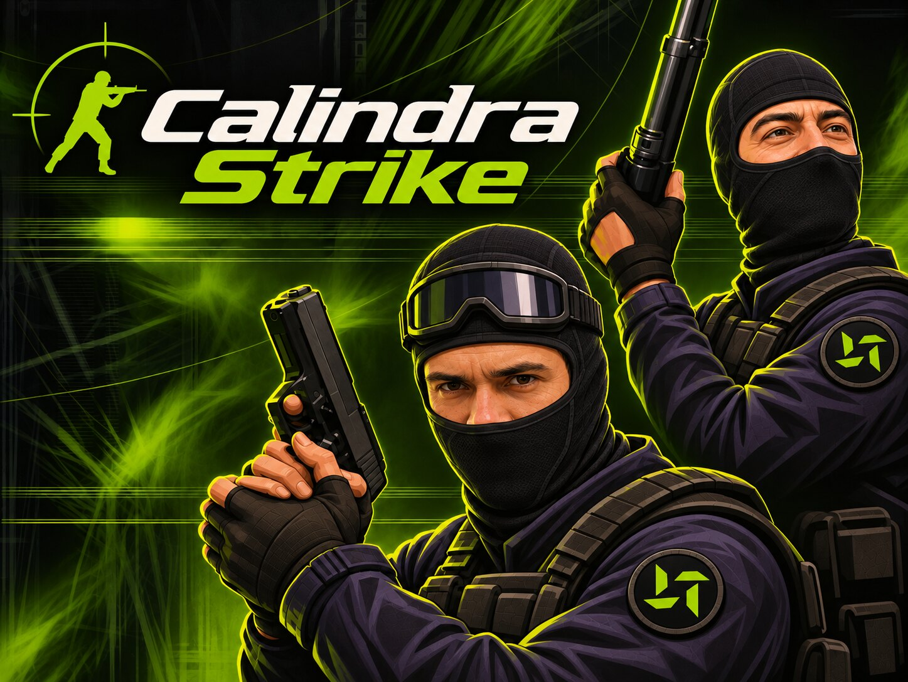

# Calindra Strike



> Tiro tático com alma de CS 1.6, direto no navegador. Salte do céu, pouse onde quiser e dispute o pódio.

An original browser FPS with Counter-Strike 1.6 style gameplay, made for the Calindra office:

- **Shopping Sul Rio**: a 3072 × 3072 unit, three floor mall built around a fountain under a glass roof. Stores on the ground floor, the food court upstairs and the **Mirante** gallery on top, which looks out over the atrium. Each half has one ascending and one descending escalator between the ground floor and food court, and another pair between the food court and Mirante. A **glass lift** beside each half of the atrium edge serves all three floors: it is one cab that everybody shares, with no buttons: it keeps going up and down, stopping about 1.5 seconds at every floor with its doors open, so step in when it arrives and step out through the doorway at your floor (each doorway is shut with a glass door while the cab is elsewhere, so you cannot step into an empty shaft, and there is no floor in it to stand on; jumping is off inside). The cab is a safe room: nobody standing in it can be shot, even though it is glass, and a shot fired from inside hurts nobody, so it is a ride and not a shooting nest. Someone in the empty shaft with the cab on another floor is not protected. Each Mirante also has a pharmacy (Droga Raio on one, Pague Pouco on the other) with a wide open storefront, and five more shops along its back wall, taken from the real Rio Sul directory as parodies: Pandorga (jewellery), Calçados Pé Leve (shoes), Semsunga (electronics), Linha Fina (stationery) and Ray-Bão (eyewear) on one half, L'Occitano (cosmetics), Perfumaria Essência (perfume), Papel & Cor (stationery), Minotauro (sports: shoes, dumbbells, rackets, balls, yoga mats, water bottles and backpacks, with try-on mirrors) and Brinco Center (toys) on the other. In the gap beside the stationery shop on each Mirante stands a Cacau Chou chocolate shop, with chocolate boxes on its back shelves, a glass display case and the till. Short ad boards and planters break up the gallery, with low planters you can hop over near the middle. Each Mirante has a **supply stand** at its middle: standing on it restores health, armour and the magazines and reserves of your primary and pistol, but only when you need it, and it refills 40 seconds after someone takes it (a green beam and a floating gift box show it is full; the box is gone while it refills). It is worth the climb and worth guarding, since the stand is in the open and the gallery is long. Bots go there when hurt or low on ammunition. Every storefront carries a parody sign drawn in code (KFG, Burguer Rei, Mania de Picanha, Batatas Douradas, ZORRA, C&Á and more). Every food court counter has a full kitchen behind it that you see over the counter but cannot enter (fryers, griddle and drinks machine for the fast food places, grill, ovens and pots for the restaurants), with tables and spinning ceiling fans in front. Each kitchen cooks in its own way and sounds like it: bubbling fryers at KFG, Batatas Douradas and Bobo's, a hissing griddle with flames under the patties at Burguer Rei, a crackling charcoal grill with a bed of flames under the skewers at Mania de Picanha, Parrilha and Outbaque, and a wood oven with its fire showing in the mouth at Madeiro. Fryer baskets sit in the oil, pans sit over the grills and griddles, and stock pots and pressure cookers steam over blue-orange burners. The fountain, kitchen sounds and the soft hum of nearby ceiling fans form a quiet background. Kitchen and fan sounds stay on their own floor. Mirante shops have a quiet ventilation hum, and music comes from speaker props. Each store has its own look: mannequins in the shop's colours, clothes racks with hangers, a full-length mirror on each side wall of the clothing stores, bookshelves and a reading corner, and Ray-Bão, the eyewear boutique on the Mirante, with three shelves of frames, a central table of open glasses and a try-on mirror on each side, shelves of chocolates, aisles of goods, and a red and white convenience store (sweets, air conditioners, fans) with only a small clothes corner. Staff work the room: they are the same mannequins the stores dress, in their brand's uniform. A cashier stands behind the till of each Mirante boutique in a polo of the brand's colour, and every food court kitchen has a cook in a white chef jacket trimmed in the brand colour and a server in the brand's polo (light blue at Mequi, chocolate brown and orange at Burguer Rei). Every ground floor store and both Mirante pharmacies have two people behind the counter, each in a closed half of the till: a cashier in the brand polo and a till mate that suits the shop, a seller at ZORRA, C&Á, H&W and Cacau Chou (ZORRA staff dress all in black), a stocker in the brand polo over work jeans at Rener and Amerikanas, a pharmacist in a white lab coat trimmed in the brand colour at Droga Raio and Pague Pouco, and one of the mall cleaners (grey-blue tunic, navy trousers, yellow trim, the same in every store) at Riachuela and the Livraria da Travessura. The store counters are too tall to jump over. They stay behind the counters, out of the aisles, and they are scenery, never players or targets. The escalator steps travel and carry you: stand still on one and it takes you up or down at 30 units per second (an ascending one up, a descending one down), and you can still walk with it or against it. The fountain has a jet and falling water, and stepping into its water splashes (a splash sound, wet footsteps while you wade, and ripples with a few droplets, which also show for other players), and ventilation ducts with grilles, fans and a faint wisp of cold vapour that sinks (the air is cold, so it falls) hum quietly when you pass them. Cover sits away from the storefronts. Ad boards, kiosks, benches and info totems break up the ground-floor aisles, with a car on display in the atrium. Menu boards and hedges break up the food court, and staggered ad boards and seating break up the Mirante. The atrium is spread out evenly, with no tables: small closed kiosks you cannot enter and slim LED totems carry digital ad screens that hold each store ad for a few seconds and slide to the next one (on the `alta` and `leve` tiers; `desempenho` keeps each screen on its first ad).
- **Shopping Sul Rio: Natal** (`shopping-natal`) dresses all three levels for Christmas. Santa rides a reindeer-drawn sleigh on the former car plinth, and standing Santas greet players upstairs. The KFG mascot wears a Santa hat. Garlands run beside storefront logos and along rails and pillars, and small trees, gifts and ornaments decorate shop interiors and food court counters. Frost trims the glass canopy, with stars hanging from its crossbars. Snow falls below the glass on the `alta` and `leve` tiers, and the mall plays “Rádio Sul Rio Natal”. The seasonal decorations are walk-through.
- **Arena match**: 5 minute rounds with a live leaderboard at the top and a 3D **top-3 podium** at the end, alongside a scrollable full ranking with kills, deaths and headshots for every player from both teams. The rotation cycles through every enabled map + mode pair (`Forja`, `Escritório`, `Shopping Sul Rio`, `Shopping Sul Rio: Natal` × every mode by default: TDM, free-for-all, CTF, debug defusion, Carrapeta Dourada, LMS and Gincana on every map, and hora de almoçar on maps with a food court), never repeating the same map or mode back to back. Pick which ones are in play with `GAME_MAPS` and `GAME_MODES`.
- **Team Deathmatch**: **Bulldogs** (lime) vs **Martelos** (blue), no friendly fire, first team to 50 kills (or most kills at the end of the timer) wins. Teams are shuffled and balanced every match, late joiners go to the smaller side, CS-style auto-balance on respawn, and you can switch to the smaller team from the Esc menu. Each side skydives over its own half; the podium shows the winning team's best three.
- **Capture the Flag**: steal the enemy flag and bring it to your base while your own flag is home. First to `CTF_CAPTURE_LIMIT` captures wins (3 by default; `0` plays to the timer); dropped flags return after 30 seconds. The objectives appear as team-colored tech backpacks with LED strips and an open compartment holding a laptop, phone and earbuds case. A backpack rides on the carrier’s back and stands upright at its base or drop point.
- **Hora de almoçar**: hostage rescue, CS 1.6 style, on the Shopping Sul Rio. Three colleagues (the players' own model, all in white) wait at the defenders' base. An attacker holds **E** next to them and they follow, walking the same path, escalators included. A colleague who reaches a restaurant counter in the food court sits down. Seat all three and the attackers win the round; when the 90 second round timer runs out, "acabaram os lugares na praça de alimentação" and the defenders win it. A leader who dies leaves the colleagues where they stand. The sides swap every round and the first to 4 rounds wins. The warmup plays the same rounds without scoring. Each round picks one restaurant of the food court (KFG, Burguer Rei, Batatas Douradas and so on) and the HUD names it: colleagues only sit down there, any other counter does not count. The chosen restaurant is marked for everybody with a tall gold beam, a pulsing ring on the floor as wide as the seating zone and its name floating over it (readable through walls), and the feed says "Destino do almoço" when the round starts. About two rounds in five are a **hora do rush**, like the Black Friday of debug defusion: the beam turns red and pulses faster, the HUD and the feed say so, and the food court fills up twice as fast, so the round lasts 45 seconds instead of 90. Each round opens with a big centred banner, like the Black Friday one: the logo of the restaurant (the same drawing as its sign in the food court) over its name, with a red "HORA DO RUSH" call under it on a rush hour. A leader also gets a small "2 de 3 colegas te seguindo" chip with one dot per colleague, so it is clear who is walking behind.
  The HUD reuses the debug defusion role chip to show the attack or defense objective, with a rush call for attackers.
- **Debug defusion**: the attackers carry "o bug", a laptop, to the plant site and hold **E** for 3 seconds to plant it. The defenders have 30 seconds (15 on a Black Friday round, "50% OFF" the fuse) to stand next to it and hold **E** for 7 seconds, while a laptop screen shows a developer fixing the bug. A defused bug scores for the defenders, an exploded one for the attackers, and the sides swap every round. If the live match ends with the bug still planted, the planting team gets one point before the podium, even if a defender has started defusing. First to `DEFUSE_SCORE_LIMIT` rounds wins (5 by default; `0` plays to the timer); a laptop left on the floor for 20 seconds goes to the other team (nobody scores, the sides swap). The warmup is practice: either team can take, plant and defuse, and there is no fuse, plant window, floor timer or Black Friday, so a team can fool around until the match starts. The plant site is the opposite base on most maps. On Shopping Sul Rio, the laptop starts at the attacking team’s base on the Mirante, the third floor. Plant inside the fountain basin on the ground floor. Defusion respawns prefer points at least 800 horizontal units from the site. After a death, the killer camera lasts up to two seconds. The camera then follows a living teammate in third person until respawn, including teammates still skydiving. With no living teammate, the camera looks level above the death position.
- **Último homem a sair do escritório (`lms`)** is free-for-all. The last surviving player wins the round. **Gincana da Calindra (`gincana`)** awards the round to the last team with any survivors. Eliminated players and late arrivals spectate until the next round, following any survivor in LMS or a living teammate in Gincana. A round with no survivors is a draw. The next round begins after four seconds (tuning), once at least two players are ready. First to five round wins (tuning) wins the match. If the match timer expires sooner, the current round scores decide the result.
- **Lead announcements** appear in the feed and as a banner. All scoring modes announce an outright leader and repeat the current lead at most once every 45 seconds (tuning). Changes during the cooldown are reflected when the next announcement is due.
- **Carrapeta Dourada**. A random player gets the golden aura and the Azeitadora. The acquisition banner says “Está tudo azeitado” and explains how to survive. Losing the objective appears in the feed as “avinagrou”. A new holder starts with 100 health and 200 armour (armour goes back to at most 100 when it is lost) and cannot collect airdrops. The holder earns a point per second outside the glass lift, and the highest score wins. While somebody holds it, only fights involving the holder deal damage: everyone else can hurt the holder and nobody else, and the holder can hurt anyone. Kill the holder and walk over the dropped Carrapeta to claim it. While it lies on the floor or waits for a redraw nobody holds it, so everyone can hurt everyone, and a death then costs 8 seconds more to respawn. If nobody picks it up before the timeout, the server draws another holder. After 45 seconds with one holder, it drops at their feet and the status strip counts down 5 seconds to a redraw among the other players if nobody else picks it up. Every match has **Batata Quente** twice (announced with a flaming potato), a 30-second frenzy in each half of the middle of the match. The holder's ammunition capacity, health and armour are halved (a holder who takes it mid-frenzy starts at 50 health and 100 armour; nothing is given back when it ends) and their points per second double every five seconds they hold it during the frenzy, up to eight points per second. Kills by the holder earn three bonus points, and killing the holder earns five. The status strip counts down to “avinagra” while someone holds the Carrapeta and shows the seconds left in Batata Quente while it is active.
- **Out of breath**. Run your sprint meter dry and you pant with deep, quick breaths until it refills, then the breathing slows and fades over a few seconds.
- **Air conditioning ducts**. The ducts of Shopping Sul Rio are sheet metal: shots ring off them as metal, and on the high graphics tier a hit leaks a faint wisp of air for two seconds.
- **Golden arsenal**. In Carrapeta Dourada the Carrapeta holder's guns are gold with walnut furniture, like the Azeitadora, and everyone's hammer becomes a red and yellow squeaky toy hammer. It is only a look: damage and timing are the same.
- **Azeitadora**. The holder's six-shot revolving launcher has infinite reserve and still needs to reload. The drum turns one chamber per shot and throws the fired round out of the gun until none is left; a reload swings it open, tips out what remains and spins it while it fills. During Batata Quente its magazine holds three rounds. Its shells blast on impact with radial damage like debug defusion's explosion. In other modes each airdrop has a 20% chance to carry the launcher with six reserve rounds. The launcher is dark with lime accents by default and wears gold and walnut in Carrapeta Dourada matches.
- **Bots** (off by default, enable with `BOT_FILL`): server-side bots fill empty slots (up to `BOT_FILL`) whenever someone is online and leave as people join. They navigate an auto-generated walkable grid (stairs, crate jumps, dropping off roofs), react with human-like delay and aim error, burst-fire and scope the AWP, hunt players and go for airdrops, respect teams in TDM/CTF, and pursue flag objectives in CTF. Bots that take enough damage may draw the hammer, charge a nearby enemy and use light swings. They switch back to their best loaded or reloadable gun as they cool down or lose the target. Flag and Carrapeta carriers only start a rush within hammer range.
- **Map vote**: during the podium everyone votes for the next match (3 map + mode options, keys 1-3 or click); most votes wins, no votes keeps the rotation. The first match after the server starts is a random map and mode from the rotation.
- **Rejoin**: a dropped connection or page refresh gets your score back if you return within 90 s.
- **Air drop**: you skydive into the arena on every (re)spawn and steer to land anywhere (a death costs 5 seconds in the two deathmatches and 12 seconds in capture the flag, debug defusion and lunch hour: `RESPAWN_TICKS` and `RESPAWN_OBJECTIVE_TICKS`, picked per mode by `respawnTicksOf`; `RESPAWN_OBJECTIVE_SECONDS` changes the second one) (`Ctrl` dives faster). Supply crates parachute in with legendary weapons and full armour. In most modes about half (52%) carry the **Mjölnir AWP**, 28% the `Ragnarök` LMG and 20% the Azeitadora; in Carrapeta Dourada it is the AWP in about 2 of 3 crates, otherwise the LMG.
- **Mjölnir = CS 1.6 AWP**: right click zooms to FOV 40 then 10 (like CS) with a clear lens and a fixed mil-dot reticle, using `zoom_sensitivity_ratio 1.2`; 115 damage (one body shot), 10-round mag; 1.6 accuracy table (stand still and scope: 0.001; crouched: perfect; walking 0.10; running 0.25; airborne 0.85; no-scope +0.08, no crosshair); the scope drops while you work the bolt and comes back on its own (right click during the bolt cancels it). Working the bolt throws the spent cartridge out of the port on a short arc to the lower right of the view.
- **Hammer**: equip slot `3` to run at 280 units/s (12% faster than a pistol), with an upright forge hammer held by its grip and a forward swing. The left hand hangs loose in the lower left of the view.
- **Day, afternoon and night**: every map runs a 15 minute cycle (day 7 min, afternoon 4, night 4, each phase easing into the next over its last 2 min). Day is the map's own look. The afternoon is golden hour, with a low warm sun and long shadows. The night has stars, a moon from another side, a cool dim light and brighter store signs, screens and lamp halos. It stays readable on purpose (players are as visible as by day, and sight range does not change), and it is only a look: bots, agents and the rules play the same. All players see the same phase because it comes from the server clock, and the kill feed says when it changes ("fim de tarde", "anoitecendo…", "amanheceu"). It costs a few uniform writes per frame, so every graphics tier has it.
- **Kill feed with weapon icons**: each kill shows the weapon as a light silhouette, Counter-Strike style, drawn from the weapon's own 3D model (the text tag stands in when the browser has no WebGL). A headshot kill adds a head-and-crosshair icon after the weapon. The pause menu's "arma principal" choice shows each weapon's silhouette beside its name.
- **CS feel**: GoldSrc movement (ground friction/accel, air strafing, crouch-jump, 1.2x bunny hop cap), spray patterns, first-shot accuracy, run-and-gun penalty, 4x headshots, armour penetration, silent walking with `Alt`, dynamic crosshair. Sprint, slide, lean and prone are in testing, see "Movimento experimental" below.
- **Netcode**: authoritative server at 60 Hz, client-side prediction with reconciliation, 100 ms entity interpolation, lag-compensated hitscan (rewind up to 250 ms), shared deterministic simulation and spread seeds.
- **Beta**: the lobby shows a lime “BETA” ribbon on the top right corner of the join card.
- **Calindra × Eitri** look: `#131312` charcoal, `#A5FA00` lime, Inter + Fragment Mono, glass tiles. All art, models and sounds are generated at runtime (no copyrighted assets).

Inspired by the LAN-party approach of [cs16-web](https://github.com/Elkhan-Isayev/cs16-web) (one server container, open a link, type a nickname, play), rebuilt from scratch as an original game so it can be hosted publicly without shipping Valve's game files.

## Architecture

The static browser client connects over WebSocket to an authoritative Node.js game server.

| Path | Purpose |
| --- | --- |
| `client/` | Vite + Three.js rendering, prediction and interface |
| `server/` | WebSocket server, match lifecycle, bots and lag compensation |
| `shared/` | Deterministic movement, collision, weapons, maps and protocol |
| `tools/` | Development bots and performance tools |

## Development

```bash
npm install
node --run dev:server
node --run dev:client
node --run test
node --run typecheck
```

The local client uses `ws://127.0.0.1:7350/ws`. Set `VITE_GAME_SERVER` at build time to use a different backend. Outside localhost, the default is `/ws` on the same origin as the frontend.

### Map speakers

Forja, Escritório, Shopping Sul Rio and Shopping Sul Rio: Natal have world speakers that play their map's station when you come within range. Adjust **música** next to **volume** in the pause menu. Music starts at 50%, follows the master volume and is muted at 0%. Station playback is browser ambience and is absent from MCP `get_state.sounds`.

To supply your own music, create `client/public/music/` and place an Ogg audio file at `forja.ogg`, `escritorio.ogg`, `shopping.ogg` or `shopping-natal.ogg` for the corresponding map. Deploy the client with those files so they are served at `/music/<station>.ogg`. The game ships with no music files. A missing or unreadable track leaves its station silent until you reload the page.

### Sound packs

Choose clássico or sound-new in the in-game sound pack menu. The separate anunciador checkbox adds a voice on top of either pack: original Portuguese kill-streak lines through the browser's speech synthesis (no audio files; silent where the browser has none). It only speaks, so shots and flags sound the same with it on or off. Packs live in `client/src/game/sound-packs/`: add a file exporting a SoundPack and register it in SOUND_PACKS in index.ts. Omitted voices fall back to classic. Runtime-loaded mods are not supported.

### Radio lines (Calindra menu)

Press B for Calindra or N for Calindra 2. The in-game menus, server validation, MCP `radio` tool and bots all read `RADIO_MENUS` in `shared/src/radio.ts`. Calindra fills its nine slots, and Calindra 2 has room for more lines.

- **Append at the end.** The wire carries an id built from the position (menu number times ten plus the slot, so Calindra uses 41-49 and Calindra 2 uses 51-52). Inserting or reordering changes what the existing ids mean for a client or an MCP agent built before the change.
- **Nine lines at most.** Players pick a line with the digits 1-9; a test fails past nine.
- **`speech` is optional.** `text` is what the feed and the menu show. Add `speech` when the text reads badly aloud (stretched letters, English words, acronyms), with the spelling the browser's speech synthesis should say.
- **Bots use it on their own.** Server bots and dev bots draw from both Calindra menus now and then (`BOT_RADIO_LINES.calindra` in `shared/src/bot-radio.ts`). To have bots say it on a specific moment instead (round start, enemy down, a plant), add its exact `text` to that trigger's list in the same file.
- **Update the agreed lines.** The first test in `shared/test/radio.test.ts` lists each menu's size and the Calindra texts on purpose, so a changed line shows up in review. Add the new one there, then run `node --run test` and `node --run typecheck`.
- **Ship server and client together.** A server without the line drops it as an unknown id, silently. Old clients still work, they just do not offer it. No `PROTOCOL_VERSION` bump is needed.
- **MCP agents.** The `radio` tool lists the lines in its description, so agents see the new one once their MCP runs the new code. For an MCP pinned to a commit (see the `bump-calindra-strike-mcp` skill), bump the pin after pushing.

## Builds and hosting

```bash
node --run build:client
```

Serve `client/dist` as static files and start the game server with `node --run start:server` (Node.js 24 or newer, it runs the TypeScript sources directly with no build step and reads `.env` if present), or use the included Dockerfile and Compose template. Configure the server environment using `.env.example`; `ALLOWED_ORIGINS` must contain the exact frontend origins. Use TLS for public connections. Hosting configuration and credentials belong to the operator's environment.

`vercel.json` is a generic static hosting template with a same-origin Content Security Policy. When using a backend on a different origin, configure both `VITE_GAME_SERVER` and the CSP `connect-src` for that origin in your deployment configuration. This repository does not select a production backend or contain production administration instructions.

## Server settings

| Variable | Default | Purpose |
| --- | --- | --- |
| `GAME_MODES` | `tdm,ffa,ctf,defuse,almoco,carrapeta,lms,gincana` | Rotation and vote modes: `tdm`, `ffa`, `ctf`, `defuse`, `almoco`, `carrapeta`, `lms`, `gincana`, or `all`. The default is every mode (empty means `all` too). `almoco` only pairs with maps that have a food court (`shopping`, `shopping-natal`) |
| `GAME_MAPS` | all | Map IDs: `forja`, `escritorio`, `shopping`, `shopping-natal` |
| `CTF_CAPTURE_LIMIT` | `3` | Captures to win; `0` uses the timer only |
| `CARRAPETA_PICKUP_TIMEOUT_SECONDS` | `20` | Seconds before reassigning a dropped Carrapeta Dourada (5–300) |
| `DEFUSE_SCORE_LIMIT` | `5` | Rounds to win debug defusion; `0` uses the timer only |
| `FRIENDLY_FIRE` | `0` | `1` lets bullets hurt teammates in team modes (a teamkill earns no kill or score); only this setting turns it on |
| `READY_KICK` / `READY_KICK_SECONDS` | `1` / `180` | Players wait on the "pronto" screen, out of the map and untouchable, when they join and again when each new match starts after the podium (the click that grabs the mouse back confirms it, and so do Enter and Space; the weapon box on that screen ends with a lime `↵ Jogar` row). With `1`, whoever has not confirmed after `READY_KICK_SECONDS` (5-600), or when the match ends, goes back to the lobby; `0` never kicks |
| `IDLE_KICK` / `IDLE_KICK_SECONDS` / `IDLE_KICK_WARMUP_SECONDS` | `1` / `60` / `300` | With `1`, a player with no input (keys, mouse, weapon change; for MCP agents, any tool call) for `IDLE_KICK_SECONDS` (10-3600) goes back to the lobby, warned 10 s before; during the warmup the limit is `IDLE_KICK_WARMUP_SECONDS` (10-3600) instead, and the clock restarts when the match starts; the podium does not count. `0` never kicks |
| `RADIO_COOLDOWN_SECONDS` / `RADIO_MAX_PER_WINDOW` / `RADIO_WINDOW_SECONDS` | `1.5` / `3` / `10` | Radio spam guard per player: minimum gap between lines (0-30 s, decimals allowed, like CS 1.6 `mp_radio_timeout`), then at most `RADIO_MAX_PER_WINDOW` lines (0-100, 0 = no cap) in any `RADIO_WINDOW_SECONDS` (1-600). Extra lines are dropped silently |
| `DEFUSE_PLANT_TIMEOUT` / `DEFUSE_PLANT_TIMEOUT_SECONDS` | `1` / `60` | With `1`, the laptop goes to the other team with a new variation when the attackers have not planted after `DEFUSE_PLANT_TIMEOUT_SECONDS` (0-3600, `0` means no limit). `0` turns the timeout off |
| `RESPAWN_OBJECTIVE_SECONDS` | `12` | Seconds a death costs in capture the flag, debug defusion, hora de almoçar and Carrapeta Dourada (1-60). The two deathmatches always use 5. The server sends the value in the match info, so the respawn countdown matches |
| `TDM_SCORE_LIMIT` | `50` | Team kill target; `0` uses the timer only |
| `MATCH_SECONDS` / `PODIUM_SECONDS` | `300` / `15` | Match and podium duration |
| `WARMUP_MIN_PLAYERS` | `2` | Players needed to start a match |
| `MAX_PLAYERS` | `24` | Human player limit |
| `BOT_FILL` | `0` | Optional server bot population target |
| `BOT_SKILL` | `50` | Bot skill, 0–100: reaction time, first-shot aim error and turn speed. The dev bots (`node --run bots`, which reads `.env`) use it too |
| `JOIN_CODE` | empty | Optional access code |
| `AIRDROP_FIRST_SECONDS` | `25` | Seconds into a match before the first AWP airdrop (1-600) |
| `MAX_PER_IP` | `32` | Connections allowed from one IP at once (1-128) |
| `TRUST_PROXY` | `0` | `1` reads the client IP from `X-Forwarded-For`; set it only behind a trusted reverse proxy (the Compose template does) |
| `HOST` / `PORT` | `127.0.0.1` / `7350` | Listen address and port for `node --run start:server`; the Docker image uses `0.0.0.0` / `7350` |

## Play with an AI agent (MCP)

`tools/mcp/` is a zero-dependency stdio [MCP](https://modelcontextprotocol.io) server that joins the game as an ordinary player, so any MCP-capable harness can play. It needs Node 24 or newer and a running server (`node --run dev:server`).

| Tool | What it does |
| --- | --- |
| `join` / `leave` | Connect with a name, colour and primary weapon, or disconnect |
| `get_state` / `wait` | Read the world (you and your floor, nearby players, air drops, supply stands, glass lifts, flags, the debug defusion bug, the hora de almoçar colleagues and restaurants, Carrapeta Dourada, score, events), or pause then read |
| `move_to` / `attack` / `hunt` / `stop` | Set a goal. A pilot routes, aims, shoots and reloads between calls. `move_to` takes an optional `y` to pick a floor on a multi-floor map; the pilot climbs stairs and escalators and rides the glass lift by itself |
| `aim` / `fire` | Free aim. `aim` holds the crosshair on a world point (`x`, `y`, `z`) or at an angle (`yaw_deg`, `pitch_deg`, pitch up positive) with the pilot standing still, and answers with the material and surface a shot would hit. `fire` holds the trigger for `ms` (50 to 5000, default 150); with the hammer in hand `heavy: true` holds the right button instead, for the heavy swing (95 damage, one per second, against 55 for the light one). Any `move_to`, `attack`, `hunt` or `stop` gives the view back to the pilot |
| `use` | Hold USE standing still: plant or defuse the bug, or as an attacker in hora de almoçar call the colleagues within 80 units. `hunt` already does both on its own |
| `jump` / `crouch` / `zoom` | Jump once (on the ground only), crouch until changed, or hold ADS with `zoom(1)` and release with `zoom(0)`. For the AWP, set scope level 0 to 2 and override auto-scoping until respawn. The hammer rejects zoom (its heavy swing is `fire` with `heavy: true`) |
| `walk` / `reload` / `switch_weapon` | Walk silently (`Alt`) until changed, reload (`R`), or switch to `primary`, `pistol`, `hammer` or `last` (`1` `2` `3` `Q`). Switching to the weapon already in hand does nothing |
| `cycle_weapon` / `spray` | Step the mouse wheel once with `direction` `next` or `previous` through primary, pistol and hammer, wrapping around (the result names the weapon it lands on). `spray` presses `G`: a decal on the wall or floor within 128 units ahead of the crosshair, 10 per spawn and 2 s apart; the server drops it silently otherwise, so read `get_state` `scene.facing.spray` or `scene.sprays` to see it landed |
| `sprint` / `slide` / `lean` / `prone` | Sprint until changed (`on`; it only runs while the pilot moves forward standing, drains stamina, and walk, crouch, prone or firing end it), slide once (needs a sprint at 240 units/s or more and 20% stamina; the result says `requested` and the reason when it cannot start), lean (`side`: `left`, `right` or `off`) or lie down until changed (`on`). A latched crouch hides the slide press, so release it first |
| `choose_loadout` / `say` / `vote` / `switch_team` | Loadout, chat, map vote and team |
| `radio` | A radio line to the team: `{ menu, line }` from the Z, X, V, B and N menus (`comandos`, `grupo`, `respostas`, `calindra`, `calindra-2`) |

The server stays authoritative. The agent is subject to the same origin check, access code, rate limits and player caps as a browser.

In Shopping Sul Rio, debug defusion puts the laptop on the Mirante and the plant site at the ground-floor fountain. Read `get_state.bomb.home` and `get_state.bomb.site` for their coordinates and floor names, and use `hunt` to navigate to the objective by role.

In LMS and Gincana, `get_state.mode` identifies the mode and `get_state.elimination` shows the round number, state (`waiting`, `playing` or `pause`), total alive and team alive counts in Gincana. During the pause, `winner` is the player ID or team index (null for a draw), and `nextAt` uses the server clock in milliseconds. Read `score.me.roundsWon` in LMS and `score.teams` in Gincana. `hunt` targets perceived rivals or opposing players and resumes next round. Lead announcements appear in recent events.

In Carrapeta Dourada, `get_state.carrapeta` reports the holder, whether you hold it, the seconds until the holder loses it (`holdSecondsLeft`, null when nobody holds it), the dropped position and seconds until a redraw, the Batata Quente countdown and your points. `hunt` goes for the dropped Carrapeta or pursues its holder when perceived. Whenever somebody holds it only the holder and whoever shoots them can damage each other, and with nobody holding it anyone can damage anyone. Read `you.magCapacity`, `you.halvedAmmo` and `you.infiniteReserve` to check the equipped weapon's ammunition rules. Airdrop entries include the weapon name and whether the crate has landed.

The server sends every living player's position to every client, so the MCP filters what it shows. By default an agent perceives an enemy only with a clear line of sight (up to 2600 units) or within 420 units (sound), plus a 10 second `lastSeen` memory, the same rules the server bots use. Pass `--omniscient` to disable the filter for debugging. `--skill` (0 to 1, default 0.7) tunes the pilot, which is the server bot brain. `--auto-vote` (off by default) casts a random map and mode vote when the podium opens; the `vote` tool can still change it. `--log` (off by default) logs joins, leaves, match changes, votes and every tool call to stderr, one line each with an ISO timestamp like the server log; stdout stays reserved for the protocol.

Register it in your harness:

```bash
claude mcp add calindra-strike -- node tools/mcp/launch.ts
codex mcp add calindra-strike -- node tools/mcp/launch.ts
```

Any other harness takes the same command in its MCP config: `command: node`, `args: [tools/mcp/launch.ts]`. Options are `--url` (default `ws://127.0.0.1:7350/ws`), `--origin` (default `http://localhost:5173`) and `--code`.

`get_state` includes `sounds`, what the agent heard since its last read: `shot` (with weapon and who fired), `impact` (with the `material` and `surface` it landed on) and `hurt`. Each carries `distance`, `bearingDeg` (positive to the right), `intensity` (0 to 1, the same inverse-distance curve the browser audio uses, full inside the reference distance of 260 units for shots and 200 for impacts) and `loudness` (`loud` from 0.5, `medium` from 0.2, `faint` below). Sounds quieter than 0.08 are not reported, and at most 12 are returned, loudest first. The server never sends a player their own shots, so those are worked out from the magazine dropping and the impact is where the crosshair meets the map; hammer swings make no sound here.

`get_state` `you` includes `stance` (`stand`, `crouch` or `prone`; `ducked` stays true for both low stances), `sprinting`, `sliding`, `stamina` (0 to 1) and `winded` (the meter emptied, no sprint until it is back to 25%) and `lean` (-1 left to 1 right). The `sprint`, `slide`, `lean` and `prone` tools set them, and `you.actions` echoes what the agent asked for (`sprint`, `lean` as `left`/`right`/`off`, `prone`, next to `crouch`, `walk` and `zoom`). The sim decides what takes effect: a lean is forced to 0 while sprinting, sliding, prone or in the air, a prone player cannot jump, sprint or slide, and `get_state` shows the result. A new input bit or remappable key needs its MCP tool: `tools/test/mcp-actions-cover.test.ts` fails otherwise.

A hurt `hunt` pilot can automatically draw the hammer and charge a nearby enemy. Active manual fire, reload, weapon switching and USE take precedence over automatic hammer switches.

On Shopping Sul Rio and its Natal variant `get_state` also reports `you.floor` (`index`, `name` and `y` of the floor you stand on: térreo, praça de alimentação, Mirante; null on one level maps), `lifts` (each glass lift nearest first, with the `floors` it serves, `riding`, `secondsToTop` while riding, and how to ride) and `supplies` (each supply stand nearest first, with its `floor`, whether it is `ready`, `secondsLeft` until it refills, `inReach` and `youNeedIt`). A `supply` event says who restocked. `hunt` walks to a full stand when the pilot is hurt or low on ammunition. Walk-in lift rides need no tool of their own: `move_to` a point on another floor (with `y`) and the pilot rides, or step into the shaft and wait: the lift needs no tool, it goes up from the ground floor and down from the Mirante by itself.

ADS is available on pistol, rifle, SMG, shotgun and LMG. It slows movement, tightens spread and ends sprinting. Reload, deploy and objective use interrupt effective aim while the request stays latched. Switching weapons, dying, respawning or leaving clears the ADS request. Read `you.aiming` and `you.zoom` (0 or 1 for ADS) for the effective result, `you.maxZoom` for the supported level and `you.actions.zoom` for the request.

`get_state` includes `timeOfDay` (`phase` `day`, `afternoon` or `night`, the `next` phase and the `blend` toward it, 0 to 1). It only says what the light looks like: agents perceive the same at night.

`get_state` includes `flags` with each team’s flag state (`at_base`, `carried`, `dropped`), carrier id/name, position, distance and bearing. `score.teams` contains team kills in TDM and captures in CTF. Flag events report `take`, `drop`, `return` and `capture`.

For Claude Code there is also a plugin that bundles the MCP and six skills (`play-calindra-strike`, `host-calindra-strike`, and `calindra-strike-combat`, `-navigation`, `-vs-bots`, `-skydive-airdrops`, distilled from the server bot code):

```
/plugin marketplace add ./
/plugin install calindra-strike@calindra-strike
```

The plugin reads `CALINDRA_STRIKE_URL`, `CALINDRA_STRIKE_ORIGIN` and `CALINDRA_STRIKE_CODE` to point at another server.

## Security

The game validates client messages, limits traffic and commands, sanitizes names and chat, checks exact origins, and supports an optional access code. The container runs as non-root with a read-only filesystem, dropped capabilities and resource limits. The Compose template publishes the game port on loopback for use behind a reverse proxy.

## Controls

In Carrapeta Dourada, walk over the dropped objective to pick it up. The Azeitadora occupies the primary slot (**1**). Fire with the left mouse button, hold the right one to aim down the sights, and reload with **R**, including when the reserve is infinite. Watch the status strip for the “avinagra” countdown and the seconds left in Batata Quente.

See also [Movimento experimental](#movimento-experimental) for sprint, slide, lean and prone.

In the lobby the **controles** button opens a page with the same list in two columns, where each key can be changed and restored, and Esc or **voltar** goes back. Default match controls. `WASD` move · `Space` jump · `Ctrl`/`C` crouch (dive while skydiving) · `Shift` sprint · `Shift` then `Ctrl` slide · `←` `→`, `F` `H` or the mouse side buttons lean · two quick crouch taps or `↓` prone · `Alt` walk silently · `1 2 3` / wheel / `Q` weapons · `R` reload · `E` hold to plant or defuse the bug · closing the tab or window mid-match asks first, because Ctrl+W is crouch plus forward · `G` spray (10 per spawn, 2 s apart) · `Mouse 1` fire · `Mouse 2` aim (hold) or AWP scope · `Tab` scoreboard · `F2` screenshot (saves a PNG of the 3D view, without the HUD) · `Y` / `T` / `Enter` chat · `Z` `X` `V` `B` `N` radio menus (comandos, grupo, respostas, Calindra, Calindra 2), then `1`-`9` to pick a line, `0` or the same key to close · `Esc` menu. The lobby, pause menu, and weapon viewer show your current bindings. The Esc menu keeps its settings on tabs, **jogo**, **áudio**, **vídeo**, **mira** and **controles**, each with an icon and its own scroll (a short tab has no scrollbar and each keeps its place). Click one or use `←` `→`, `Home` and `End` on the tab bar; the menu reopens on the tab you last used, and the buttons below stay in place. The tab table and its keys are in `client/src/ui/overlays.ts` and `client/src/ui/menu-tabs.ts`.

### Remapping controls

Open **controles** from the Esc menu. Select an action's current shortcut and press a key or mouse button. Weapon controls also accept the scroll wheel. A custom shortcut replaces all default shortcuts for that action. If another action already uses the shortcut, the menu names it and asks before sharing. Use **padrão** on a row to restore that action or **restaurar todos** to restore all defaults. Changes take effect when you resume and are saved in this browser.

Esc stays fixed for the pause menu and capture cancellation. Radio menu keys and choices, chat submit and cancel, ready screen, votes, menu navigation, and spectator shortcuts are fixed in their own contexts. Browsers and operating systems may intercept some shortcuts.

### Movimento experimental

These moves are still being tested. Use the GitHub **issues?** link in the lobby or the Esc menu to open a new [issue](https://github.com/sandhilt/calindra-strike/issues) in a new tab and share feedback. The issue body comes prefilled with the build commit, protocol version, browser, window size and language. The movement changes bumped `PROTOCOL_VERSION`, so older tabs must reload.

- **Sprint**: hold `Shift` while moving. Sprinting blocks shooting and ends when you fire. It only tires you while you really move: holding `Shift` against a wall, or standing still, costs no stamina and does not refill it either.
- **Fôlego**: a bar at the bottom centre of the HUD, with a bolt icon and the percentage. It shows while you sprint, slide, refill or are winded, and fades when full. Green when healthy, amber below 40%, red and pulsing with "sem fôlego" (and a faint red edge) when winded. The white mark on the bar is where sprint comes back (25%). About 5 s of sprint, 6 s to refill.
- **Postura**: next to health and armour, a body silhouette shows whether you stand, crouch or lie down, with its name under it. It turns lime while you are lowered and follows every change at once.
- **Slide**: press `Shift` then `Ctrl` while moving fast.
- **Lean**: `←` or `F` or the mouse back button leans left, `→` or `H` or the forward button leans right. The eye and the gun move the most (18 units), the head hitbox less (9) and the body hardly at all (3), so a lean behind cover shows the weapon first. In the first-person view the gun also slides out a little further, and other players' avatars reach out with the arms while the torso barely tilts. A wall stops it.
- **Prone**: tap `Ctrl` (or `C`) twice within 0.3 s to lie down, like in war games; one more tap gets up. `↓` still toggles directly. A `Ctrl` press while `Shift` is held is the slide, never prone. Slow, small target, 0.3 s lock between changes, no jump.
- **Death spectate (debug defusion)**. After the killer camera, **left click / →** follows the next living teammate and **right click / ←** follows the previous one. The HUD names the teammate you are watching.
- **Mira (botão direito)**: hold the right button to aim down the sights of the pistol, rifle, SMG, shotgun and machine gun. The gun slides to the centre of the view and the field of view narrows, the mouse turns slower and the weapon is steadier (tighter spread) but you walk slower. The rifle carries a red dot optic: the gun stays in view, raised so the dot sits on the centre of the screen, and the crosshair gives way to the lit dot. Aiming ends a sprint, drops while you reload or swap weapons and comes back by itself if you are still holding the button, and crouching, lying down, sliding, leaning and jumping all keep it. The hammer keeps its heavy swing on the right button, and the AWP uses its telescopic scope (right button toggles 40° and 10°). Other players, and spectators following one, see the gun raised toward the eye. The aim and the red dot work on every graphics tier. In the debug weapon viewer, **mirando** previews the pose, red dot included.
- **Silent walk** moved to `Alt`.
- Bots do not use these moves. MCP agents press them with the `sprint`, `slide`, `lean` and `prone` tools and read the result in `get_state.you`.

### Debug mode

Enter `↑ ↑ ↓ ↓ ← → ← → B A` in the lobby to preview weapons or pick **cenário** to explore a map. Click the map to fly with the mouse, WASD, Space and Ctrl. Hold Shift to go faster and press Esc to reopen the panel. Set **movimento** to **andar** to walk the map as a player: WASD moves, Space jumps, Ctrl crouches, Shift sprints, left click fires the **arma** you picked with its tracers, impacts and surface sounds, and R reloads. **sons do cenário** plays the map's ambient sounds and music, as in a match. F3 toggles the FPS, frame timing and memory readout in both modes. Use **maximizar janela** in either mode to enter browser fullscreen and **sair da tela cheia** to leave it. Returning to the lobby exits debug fullscreen.

### Graphics (modo desempenho)

The lobby's **Joga melhor em tela cheia** hint offers a **tela cheia** button in browsers that support fullscreen. The hint disappears while fullscreen is active.

The lobby and the Esc menu have a **gráficos** setting with three tiers: `alta`, `leve` and `desempenho`. Use `desempenho` on weak machines such as laptops with integrated graphics: it draws at about 65% of the window resolution (the canvas still fills the window), turns off sun shadows and edge smoothing, and drops barrel smoke and ejected casings. Gameplay is the same on every tier, only visuals change. Everything applies at once except edge smoothing, which waits for the next join. The moving scenery follows the tier too: vent fans, the fountain's water and jet, the vent vapour, the ripples where feet meet water and the kitchen flames and steam run on `alta` and `leve` and stand still on `desempenho` (the vapour, the ripples, the flames and the steam are not even built there). The splash and wet footstep sounds play on every tier. The ceiling fans and the escalator steps keep moving on every tier. The falling snow of the Natal mall runs on `alta` and `leve` and is not built on `desempenho`. The vent and ceiling fan hum, the fountain's splash and the cooking sounds play on every tier. If a match stays under about 30 fps after the first seconds, a one-time hint suggests the performance tier. The per-tier values live in `client/src/game/render/quality.ts`.

The AWP has no crosshair, and shots without the scope are less accurate. Raising the scope shows a clear lens with a black surround and a mil-dot reticle. The lenses on the gun model are dark blue-green coated glass with a faint lime glint.

Only `alta` has the extras. Bullet impacts throw sparks coloured by the surface, with long yellow glints on metal, containers and concrete (`fx.sparkle`). And a light, screen-space take on ray-traced lighting adds contact shadow in corners and under cover (`lightRt`): WebGL has no hardware ray tracing, so it is an ambient-occlusion pass that marches rays through the depth buffer. It runs only on a real WebGL 2 card with room for the extra passes (`client/src/game/render/rt-support.ts`), never on a software renderer, and switches itself off for good if it ever throws. The pause menu's **sombra de contato** choice under **vídeo** (it was called ray tracing, but it is not) has `automático` (the default), then the fixed steps `desligado`, `leve`, `médio` and `alto`, and applies mid-match. Each step keeps the effect and lowers its cost: `médio` runs the occlusion at half resolution with 6 rays and light edge smoothing and looks almost the same as `alto`, which is the full-cost pass (full resolution, 8 rays, 4x MSAA). `automático` starts at `alto`, and at `médio` on integrated graphics (Intel, AMD APUs), then steps down if frames stay slow. On a laptop with a discrete card, make sure the browser runs on it (Windows: Settings > System > Display > Graphics > the browser > High performance): on the test laptop the same benchmark ran at 38 fps on the Intel iGPU and 106 fps on the RTX 4070, and the game says so once when frames are slow on an integrated card. `leve` uses 3 rays and a weaker shadow. `automático` starts at `alto`; if the median frame stays over 33 ms (below 30 fps) for 3 s, or more than one frame in twenty drops below 24 fps, the game steps the level down once more (never below `leve`, never back up during that match) and says so in the feed. A fixed step never changes by itself. A save from the old on/off switch becomes `automático` (was on) or `desligado` (was off). The high tier also draws at most 1.5 device pixels per CSS pixel. The levels live in `client/src/game/render/rt-levels.ts`.

The benchmark always draws full day, so runs stay comparable.

### Benchmark

In the lobby, choose **testar desempenho** next to the graphics settings. The pause menu has the same button under **vídeo**; it leaves the match first, since a match running beside the test would skew it, and opens the test in the lobby. The camera walks a fixed route through each map at player walking speed, with eased turns. Short runs cover the start of the route. The live panel shows the current tier, map and progress, FPS averaged over roughly half a second, frame time, CPU and GPU time per frame, the GPU name when exposed by the browser, logical cores and JS heap size when available. The result card shows average FPS, the share of frames within the 60 fps budget with a 5% tolerance, and median CPU and GPU time per tier. It recommends the highest tier that reaches 90%, or the tier with the best percentage if none reaches 90%. Use the result card to save that tier. The results apply to the current browser and window size.

To run without the lobby, open `/?benchmark&tiers=high,high-no-rt,low,performance&maps=forja,escritorio,shopping,shopping-natal&rounds=2&ms=3000`. All maps and the three player tiers are the defaults, with one round and 3000 ms of measurement after a 1000 ms warmup per run. `high` runs the default ray tracing level (`médio`). `high-no-rt`, `high-rt-light`, `high-rt-medium` and `high-rt-high` match `high` with the ray pass off or pinned to one level, to show which keeps 60 fps on your card; they are excluded from recommendations. Read `window.__benchmark` when the title is `benchmark:done`, or capture the `[benchmark]` console line. Each run and tier has median `cpuMs` and `gpuMs` fields. CPU time is wall time around the main-thread update and render submission. GPU time comes from nonblocking WebGL 2 timer queries via `EXT_disjoint_timer_query_webgl2`. `gpuMs` is `null` when no valid query result is available. On a dev server you can also pass a URL-encoded HTTP(S) loopback collector as `report` for a no-CORS JSON POST to `localhost` or `127.0.0.1`.

### Impact sounds

A bullet sounds different on each surface, on every tier. The 21 map materials fall into 13 surfaces (`ground`, `concrete`, `plaster`, `brick`, `tile`, `metal`, `container`, `wood`, `crate`, `glass`, `screen`, `cloth`, `plant`) in `shared/src/surface.ts`, and each surface is a short stack of synthesised layers in `client/src/game/surface-sound.ts` (no sample files). Glass, plants and the lime trim let bullets through, so they never make an impact sound. A new material needs a surface, a sound layer set and a spark look, or the typecheck fails.

### Weapon side

The Esc menu has a **lado da arma** setting, `direita` (default) or `esquerda`. The first-person gun and its hands are mirrored to the left of the view, including the kick, the reload roll and the bolt cycle (the cartridge arc flips too). It applies at once and is saved with the other settings; other players' models do not change. The mirror is a group above the kick group in `client/src/game/render/viewmodel.ts`, and the weapon viewer (debug mode) has a `canhoto` switch to preview it.

### Watching a match

Choose **só assistir** in the lobby to watch without taking a player slot. A
player can also pick **assistir** in the Esc menu: it leaves the player slot and
rejoins the same server as a spectator. In team modes the spectator bar at the
bottom offers both teams (keys `1` and `2`); pick one within 15 seconds, or on
timeout the server selects the smaller team (ties use the score, then chance).
FFA starts watching immediately. A spectator watches one team at a time and can
switch whenever they like. Returning from FFA to TDM opens a fresh team choice.
Up to 16 spectators can connect independently of the player limit. Spectators
receive chat but cannot send it, play or vote.

The always-visible bar shows who is followed, the camera mode, the team buttons
and key hints. Spectator controls, as in CS 1.6:

- `Space` cycles the camera: first person (you see their weapon with its recoil,
  reload and switch animations, and your own crosshair style at the centre, hidden
  while the target is scoped, skydiving or holding the sniper), locked third person
  (chase camera on the player's back, turning with their view), free third person
  (the mouse orbits the camera around the player; click once to lock the mouse) and
  free camera. Both third-person cameras are pulled in when a wall is in the way.
- `Left click` or `→` follows the next player, `Right click` or `←` the previous one.
- Free camera: `WASD` fly along the view, `Shift` faster, `E` up, `Q`/`C` down.
  Click the screen to lock the mouse for looking around and `Esc` to release it.
- `1` / `2` watch the first or second team, `Tab` shows the scoreboard, `Esc` opens the menu.
- `J`, the **entrar no jogo** button on the bar or the one in the Esc menu joins
  the match as a player. If the server is full you keep watching.

Whatever player a spectator follows, planting or defusing the bug shows a progress
bar with who is doing it.
